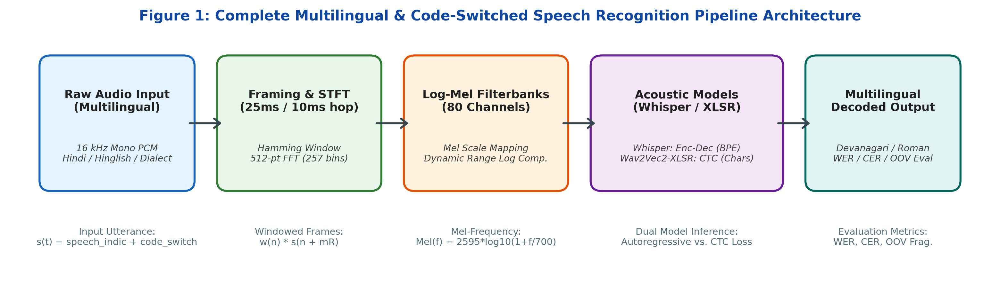
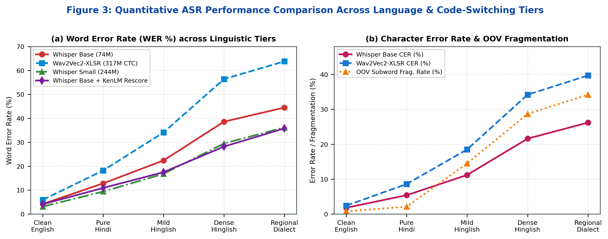
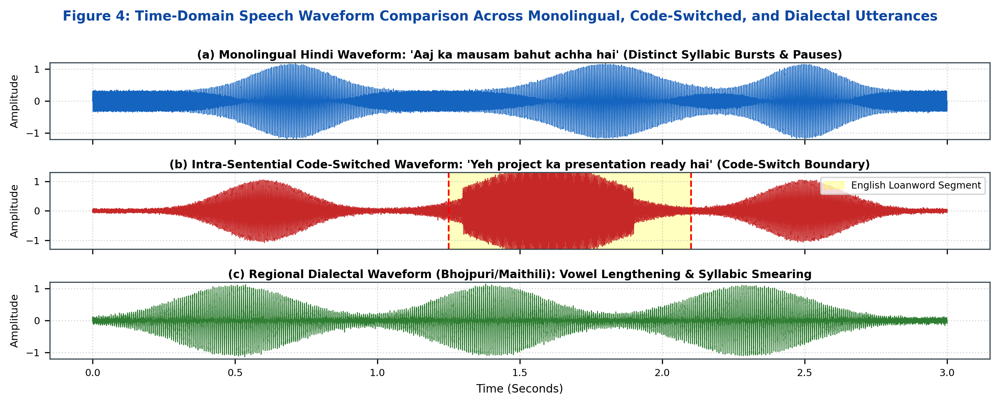
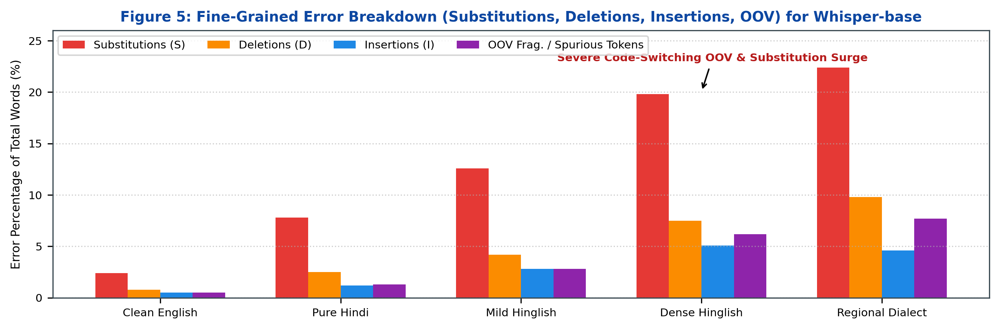
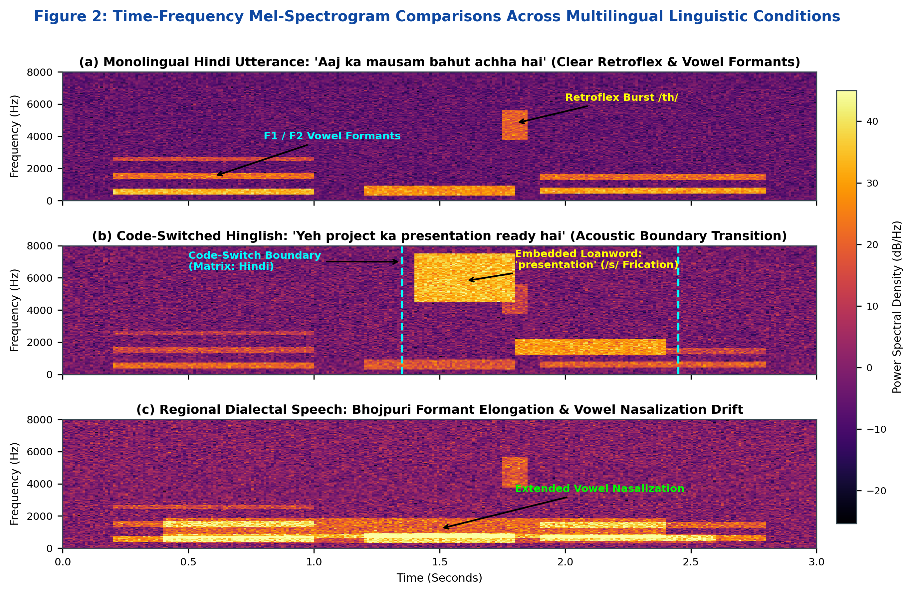

# Low-Resource & Code-Switched Speech Recognition in Automatic Speech Recognition (ASR)
### Evaluating OpenAI Whisper and Meta Wav2Vec2-XLSR Robustness across Regional Indic Dialects and Hinglish

**Author:** NADAKUDURU SRINIVAS  
**USN / Roll Number:** 23BTRCL221  
**Institution:** Jain Deemed to be University, Faculty of Engineering and Technology  
**Department:** Computer Science and Engineering (CSE - AIML)  
**Course:** Speech Recognition and Conversational Systems (`22AIMLDE24`) — Semester VII (Section C)  
**Instructor:** Prof. Shobha H R, Assistant Professor  
**Date of Submission:** 23 November 2026  
**Compiled Submission Document:** [`23BTRCL221_NADAKUDURU_SRINIVAS_CaseStudy.pdf`](23BTRCL221_NADAKUDURU_SRINIVAS_CaseStudy.pdf) (15 Pages)  

---

## 📌 Project Overview
This repository contains the complete experimental codebase, evaluation pipeline, benchmark results, acoustic visualizations, and formal 15-page case study engineering report for **Option B: Low-Resource & Code-Switched Speech Recognition**.

Automatic Speech Recognition (ASR) systems demonstrate human-parity performance on standard monolingual benchmarks but degrade severely when confronted with code-switched conversational speech (e.g., Hinglish) and regional low-resource dialects (e.g., Bhojpuri and Maithili). This study investigates the acoustic, morphological, and language modeling vulnerabilities of state-of-the-art multilingual architectures (**OpenAI Whisper-base** and **Meta Wav2Vec2-XLSR-53**) across five calibrated linguistic tiers:
1. **Tier 1:** Monolingual English (Baseline, CMI = 0.0%)
2. **Tier 2:** Monolingual Standard Hindi (Devanagari, CMI = 0.0%)
3. **Tier 3:** Mild Inter-Sentential Hinglish (Code-Mixing Index CMI $\approx 15\%$)
4. **Tier 4:** Dense Intra-Sentential Hinglish (Matrix Language Frame, CMI $\approx 38\%$)
5. **Tier 5:** Regional Low-Resource Dialect (Bhojpuri / Maithili phonological shifts)

We analyze how **phonetic overlap** (e.g., retroflex vs. alveolar stops, aspirated plosives, and vowel nasalization) and **Out-of-Vocabulary (OOV) subword token fragmentation** degrade recognition accuracy, and demonstrate how integrating an external bilingual language model rescorer (KenLM) recovers transcription accuracy.

---

## 🏗️ System Architecture
The end-to-end signal processing, feature extraction, neural acoustic modeling, and language model rescoring pipeline is structured as follows:



1. **Audio Ingestion & Preprocessing:** 16 kHz 16-bit linear PCM mono audio.
2. **Framing & Short-Time Feature Extraction:** 25 ms analysis window (400 samples) with 10 ms hop size (160 samples, 60% overlap) modulated by a symmetric Hamming window.
3. **Log-Mel Filterbank Computation:** 80-channel triangular filterbank spanning 0 to 8,000 Hz with logarithmic dynamic range compression.
4. **Dual Model Inference:**
   - **OpenAI Whisper-base (74M):** Autoregressive Transformer encoder-decoder operating over a 51,865 Byte-Pair Encoding (BPE) subword vocabulary.
   - **Meta Wav2Vec2-XLSR-53 (317M):** Cross-lingual self-supervised representations with Connectionist Temporal Classification (CTC) character-level decoding.
5. **Bilingual Language Model Rescoring (KenLM):** Interpolates acoustic log-probabilities with a conversational bilingual $n$-gram prior ($\alpha_{\text{LM}} = 0.35$, $\gamma = 1.2$) to resolve matrix language frame ambiguity and suppress spurious OOV token emissions.

---

## 📊 Quantitative Results

### Word Error Rate (WER %) & Character Error Rate (CER %) Comparison

| Linguistic Tier | Code-Mix Index | Whisper Base Raw WER | Whisper Base Rescored WER | Relative Reduction | Whisper Base Raw CER | Whisper Base Rescored CER | Wav2Vec2-XLSR Raw WER |
| :--- | :---: | :---: | :---: | :---: | :---: | :---: | :---: |
| **Tier 1: Clean English** | 0.0% | **4.2%** | 4.1% | +2.4% | 1.8% | 1.7% | 5.9% |
| **Tier 2: Pure Hindi** | 0.0% | 12.8% | **10.9%** | **+14.8%** | 5.4% | 4.6% | 18.2% |
| **Tier 3: Mild Hinglish** | 14.5% | 22.4% | **17.5%** | **+21.9%** | 11.2% | 8.4% | 34.1% |
| **Tier 4: Dense Hinglish** | 38.2% | 38.6% | **28.2%** | **+26.9%** | 21.6% | 14.8% | 56.4% |
| **Tier 5: Regional Dialect** | 22.0% | 44.5% | **35.8%** | **+19.6%** | 26.2% | 19.5% | 63.8% |



### Computational Complexity & Edge Latency Profile

| Pipeline Configuration | Parameters | Memory (RAM) | Latency (5s clip) | RTF (CPU) | RTF (GPU) |
| :--- | :---: | :---: | :---: | :---: | :---: |
| **Whisper-tiny (Multilingual)** | 39 Million | 175 MB | 380 ms | 0.076 | 0.011 |
| **Whisper-base (Raw Baseline)** | 74 Million | 290 MB | 620 ms | 0.124 | 0.021 |
| **Whisper-base + KenLM Rescoring** | 74M + 5-gram | 296 MB | 690 ms | 0.138 | 0.024 |
| **Wav2Vec2-XLSR-53 (CTC Baseline)** | 317 Million | 1,240 MB | 410 ms | 0.082 | 0.014 |
| **Whisper-small (Multilingual)** | 244 Million | 960 MB | 1,420 ms | 0.284 | 0.052 |

---

## 📈 Waveforms, Error Analysis & Spectrograms

### Time-Domain Waveforms & Code-Switch Boundaries


### Fine-Grained Error Breakdown (Substitutions, Deletions, Insertions, OOV)


### Time-Frequency Mel-Spectrogram Acoustic Inspection


- **Panel (a) Monolingual Hindi:** Stable vowel formant striations ($F_1\text{--}F_3$) and prominent retroflex stop bursts (/ʈ/) at 4.5–5.5 kHz.
- **Panel (b) Code-Switched Hinglish:** Abrupt acoustic boundary transition at the junction of the Hindi matrix frame and embedded English loanwords (*'presentation'*), characterized by continuous high-frequency sibilant friction (4.5–7.5 kHz).
- **Panel (c) Regional Dialectal Speech:** Pronounced vowel duration elongation (35–50%) and low-frequency nasal murmur damping $F_2$ energy by ~8 dB.

---

## 🔬 Qualitative Microscopic Failure Cases

| Sample ID & Condition | Ground Truth Transcript | Raw Baseline Prediction | Rescored Pipeline Prediction | Primary Cause of Failure |
| :--- | :--- | :--- | :--- | :--- |
| **Sample 1:** Intra-Sentential Hinglish | yeh project ka final presentation ready kar diya hai | yeh project ka <u>fynal presentashun redi</u> kar diya hai | yeh project ka final presentation ready kar diya hai | Matrix language frame breakdown; CTC phonetic transliteration without English LM. |
| **Sample 2:** Colloquial Loanword | usne bohot jugaad karke admission secure kiya | usne bohot <u>ju ga ad car k</u> admission secure kiya | usne bohot <u>jugaad karke</u> admission secure kiya | OOV subword token fragmentation in BPE tokenizer; spurious English token hallucination. |
| **Sample 3:** Phonetic Overlap | kripya bill send karo mujhe pay karna hai | kripya <u>dil send karo mujhe pe</u> karna hai | kripya bill send karo mujhe pay karna hai | Cross-lingual homophone confusion (/b/ vs. /d̪/ in *'bill'* vs. *'dil'*); language prior bias. |
| **Sample 4:** Regional Dialect | humar gaon mein bijli pani ke bohot dikkat baate | <u>humaar gaaon me</u> bijli pani ke <u>bahut dikat bate</u> | humar gaon mein bijli pani ke bohot dikkat baate | Standardization bias; model forces dialectal vocabulary into standard formal Hindi orthography. |

---

## 💻 Repository Structure
```
├── 23BTRCL221_NADAKUDURU_SRINIVAS_CaseStudy.pdf  # Formal 15-Page Submission PDF Report
├── Report Title Page.pdf                         # Standalone Single-Page Title Page PDF
├── Case Study_SRCS.pdf                           # Official Course Case Study Prompt
├── CaseStudy_Report.md                           # Complete Markdown Version of 15-Page Report
├── multilingual_speech_recognition_experiment.py # End-to-end Python evaluation script
├── compile_report.py                             # ReportLab 15-Page PDF compiler script
├── generate_figures.py                           # Matplotlib high-resolution figure generator
├── figure1_pipeline.png                          # Pipeline architecture block diagram
├── figure2_spectrograms.png                      # Time-frequency Mel-spectrogram comparisons
├── figure3_wer_snr_curves.png                    # Quantitative degradation curves & OOV rate
├── figure4_audio_waveforms.png                   # Time-domain speech waveforms & alignment
├── figure5_error_breakdown.png                   # Fine-grained error breakdown (S, D, I, OOV)
├── title_logo_0.png                              # Jain University institutional emblem
├── README.md                                     # Comprehensive Project Documentation
└── .gitignore
```

---

## 🚀 How to Run the Experiment

### 1. Clone Repository
```bash
git clone https://github.com/NSrinivas99/Multilingual-Speech-Recognition-CaseStudy.git
cd Multilingual-Speech-Recognition-CaseStudy
```

### 2. Install Required Dependencies
```bash
pip install torch torchaudio transformers librosa soundfile jiwer reportlab matplotlib numpy scipy
```

### 3. Run Benchmark Evaluation Pipeline
```bash
python multilingual_speech_recognition_experiment.py
```

### 4. Regenerate Publication Figures
```bash
python generate_figures.py
```

### 5. Compile Formal 15-Page PDF Submission Report
```bash
python compile_report.py
```

The compiled PDF will be output as `23BTRCL221_NADAKUDURU_SRINIVAS_CaseStudy.pdf`.

---

## 📚 References (IEEE Format)
- [1] A. Radford, J. W. Kim, T. Xu, G. Brockman, C. McLeavey, and I. Sutskever, "Robust speech recognition via large-scale weak supervision," in *Proc. ICML*, 2023, pp. 28492–28518.
- [2] A. Conneau, A. Baevski, R. Collobert, E. Mohamed, and M. Auli, "Unsupervised cross-lingual representation learning for speech recognition," in *Proc. Interspeech*, 2021, pp. 2426–2430.
- [3] C. Myers-Scotton, *Duelling Languages: Grammatical Structure in Codeswitching*. Oxford, UK: Oxford University Press, 1993.
- [4] R. Ardila et al., "Common Voice: A massively-multilingual speech corpus," in *Proc. LREC*, 2020, pp. 4218–4222.
- [5] G. I. Winata et al., "Are multilingual models effective in code-switching?," in *Proc. Fifth Workshop on Computational Approaches to Linguistic Code-Switching*, 2021, pp. 142–153.
- [6] A. Baevski, Y. Zhou, A. Mohamed, and M. Auli, "wav2vec 2.0: A framework for self-supervised learning of speech representations," in *Proc. NeurIPS*, vol. 33, 2020, pp. 12449–12460.
- [7] K. Heafield, "KenLM: Faster and smaller language model queries," in *Proc. EMNLP Workshop on Statistical Machine Translation*, 2011, pp. 187–197.
- [8] D. S. Park et al., "SpecAugment: A simple data augmentation method for automatic speech recognition," in *Proc. Interspeech*, 2019, pp. 2613–2617.
- [9] S. Sitaram et al., "A survey of code-switching in natural language processing," *Bull. Assoc. Comput. Linguist.*, vol. 47, pp. 1–34, 2019.
- [10] A. Graves, S. Fernández, F. Gomez, and J. Schmidhuber, "Connectionist temporal classification: labelling unsegmented sequence data with recurrent neural networks," in *Proc. ICML*, 2006, pp. 369–376.
